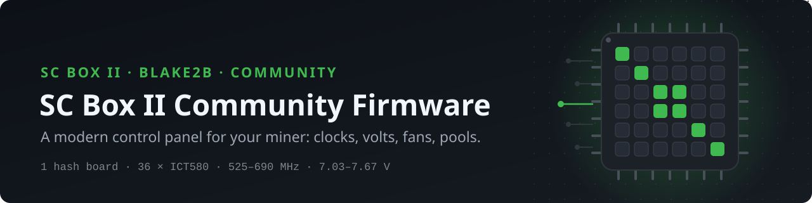
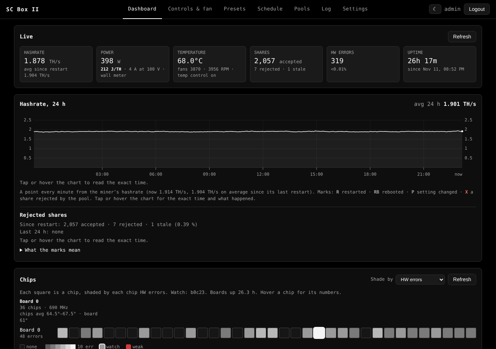
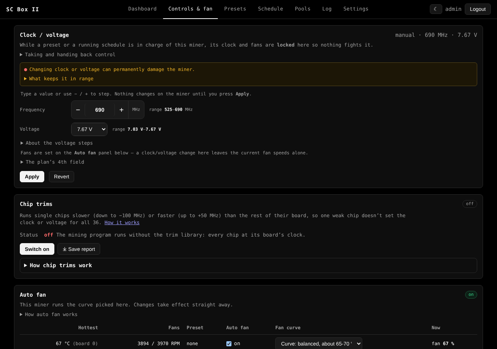
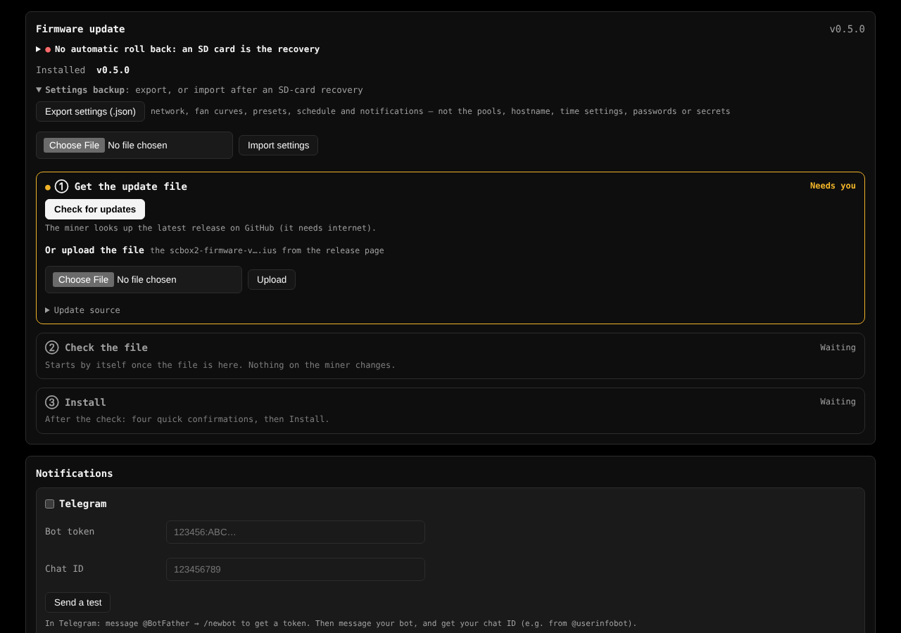
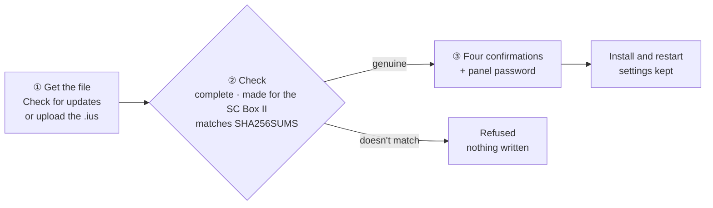
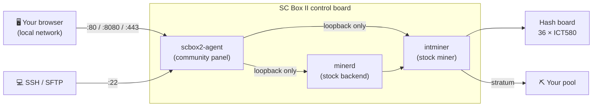

<p align="center">
  <picture>
    <source media="(prefers-color-scheme: dark)" srcset="assets/banner.svg">
    <source media="(prefers-color-scheme: light)" srcset="assets/banner-light.svg">
    
  </picture>
</p>

<p align="center">
  <a href="https://github.com/christhealien/scbox2-community-firmware/releases/latest"></a>
  
  
  
  
</p>

<h3 align="center">A modern control panel for the SC Box II miner</h3>

<p align="center">
  Clock and voltage control in volts · per-chip trims · fan curves · a weekly schedule ·<br>
  no cloud, local network only · one-click updates from GitHub
</p>

<p align="center">
  <a href="#quick-start"><b>Quick start</b></a> ·
  <a href="#highlights">Highlights</a> ·
  <a href="docs/INSTALL.md">Install</a> ·
  <a href="#updating">Updating</a> ·
  <a href="docs/SECURITY.md">Security</a> ·
  <a href="docs/BUILDING.md">Build</a> ·
  <a href="#faq">FAQ</a>
</p>

<p align="center">
  
</p>

> [!WARNING]
> **Early release.** The hardware controls in v0.5.0 were tested on one SC Box II. Custom firmware can void your
> warranty and, in the worst case, damage the miner. Read [Safety](#safety) before you flash.

## Highlights

<table>
<tr>
<td width="50%" valign="top">

#### ⚙️ Control
- **Clock** 525–690 MHz, never above stock
- **Voltage in volts:** 20 steps from 7.67 V (stock) down to 7.03 V
- **Per-chip trims** (−100 to +50 MHz) and **auto-trim** for weak chips
- **Presets** *Stock High* and *Stock Low*, plus your own, each with its own fan curve
- **Stop hashing / Idle** from the panel, checked until the board has cooled

</td>
<td width="50%" valign="top">

#### 📊 Monitoring
- **Live dashboard** and a 24-hour hashrate chart
- **All 36 chips** on one map, with weak chips flagged
- **Power estimate** in W and J/TH, calibrated with your own plug-in meter
- **Rejected shares** with the pool's reason; HW-error **warm-up summary**
- **Notifications** to Telegram, Discord, ntfy, Gotify or a webhook

</td>
</tr>
<tr>
<td width="50%" valign="top">

#### 🌡️ Fans and heat
- **Auto fan** with fan curves you drag into shape
- **Thermal guard:** fans to 100 % and stop hashing before the 86 °C hardware cut-off
- **Weekly schedule:** paint the week with presets or Idle, plus scheduled restarts

</td>
<td width="50%" valign="top">

#### 🔐 Private by design
- **No cloud.** The factory phone-home code is removed or disabled
- **Local network only** by default; HTTPS, port switches, outside access off
- **Runs fully offline** with a pool on your LAN; set the clock by hand
- **One password** for panel and SSH, changed at first sign-in

</td>
</tr>
</table>

<p align="center">
  
  
</p>

## Quick start

1. Download `scbox2-sd-v0.5.0.img.xz` and `SHA256SUMS` from the
   [latest release](https://github.com/christhealien/scbox2-community-firmware/releases/latest) and check the hash.
2. Write the image to a microSD card with **balenaEtcher**.
3. Power the miner off, insert the card, power it on. Wait about 4 minutes until only the blue SYS LED flashes,
   then remove the card.
4. Find the miner's address on your router and open `http://<miner-ip>/` from a device on the same network. Sign
   in with `admin` / `admin` and set your own password.
5. Add your pool in the **Pools** tab. Mining starts by itself within about a minute.

Step by step, with first sign-in and recovery: **[docs/INSTALL.md](docs/INSTALL.md)**.

> [!IMPORTANT]
> **An SD flash wipes the miner's settings.** Export them first (**Settings → Firmware update → Settings backup**)
> and import them afterwards; pools, hostname and time settings aren't in the file
> ([what's included](docs/INSTALL.md#settings-backup)).

## What's in v0.5.0

| Feature | v0.5.0 |
|---|:---:|
| Monitoring, pools and pool guard, notifications, schedule, logs, SSH, time | ✅ |
| Stop hashing / Idle, with safety guards and scheduled Idle | ✅ |
| Power estimate (W, J/TH), calibrated with your meter | ✅ |
| Clock control, 525–690 MHz | ✅ |
| Voltage control, 7.67 V → 7.03 V | ✅ |
| Per-chip clock trims and auto-trim | ✅ |
| Firmware update from the panel, checked and password-protected | ✅ |
| Local-network-only access, HTTPS only, port switches | ✅ |
| Clock ceiling probe | 🕓 later |
| Overclock above 690 MHz | 🕓 later |
| Auto-tuner | 🕓 later |

Full history: [CHANGELOG.md](CHANGELOG.md).

## Updating

After the first install, update from the panel: **Settings → Firmware update**.



- **Download and install** does all three steps in one go from the latest release.
- The four confirmations: settings saved · SD card ready · power stable · *"I understand that if the install
  fails, the miner only comes back with the firmware on an SD card."*
- There is **no automatic roll back** on this miner. The update writes only the system partition and reads it
  back; if it ever fails, an SD card with the firmware brings the miner back. Keep one ready.

| Release file | What it is for |
|---|---|
| `scbox2-firmware-v0.5.0.ius` | Update from the panel (keep the name: the panel looks for it) |
| `scbox2-sd-v0.5.0.img.xz` | First install, or recovery, from a microSD card |
| `scbox2-firmware-v0.5.0-source.tar.gz` | The source: panel, build kit, docs |
| `SHA256SUMS` | SHA-256 of the files above |

## How it works

The new panel replaces the miner's web interface. The stock mining programs keep running the hash board, and the
panel talks to them over loopback only, so nothing on your network can reach them directly.



| | |
|---|---|
| **Miner** | SC Box II (Blake2b / Siacoin): 1 hash board, 36 ICT580 chips, 2 fans |
| **Control board** | MCB_V6_3_5, InfoTM iMAPx910 (ARMv7), Ethernet only |
| **Panel** | port **8080** (HTTP and HTTPS, can be moved), also 80 and 443; SSH/SFTP on 22 |
| **Stock presets** | **Stock High** 690 MHz (about 1.9 TH/s on one unit), **Stock Low** 525 MHz |
| **Based on** | the stock SC Box II firmware 2.2.1 (not included here) |

## Security & privacy

| Port | What | Default |
|---|---|---|
| 8080 | Panel, HTTP and HTTPS | always on; can be moved (1024+) |
| 80 / 443 | Panel (HTTP / HTTPS) | on; can be switched off |
| 22 | SSH and SFTP, with the panel account | on; can be switched off |

- **Local network only** by default (IPv4 and IPv6). Outside access is a switch, off by default, and needs your
  password to turn on.
- **No phone-home.** The factory cloud client, its discovery reports, the UDP set-IP responder, the internet
  checks and the hardcoded overseas DNS and time servers are removed or disabled. The stock programs answer on
  loopback only.
- **By default the miner contacts only** your router (DHCP), time servers (yours and the router's, then
  `pool.ntp.org`, which can be switched off) and DNS for their names. Pools, your DNS servers, notifications and
  GitHub only when you set them up or ask for an update.
- **Runs fully offline** with a pool on your LAN. Set the clock by hand in **Settings → Time**.
- **One password** for panel and SSH. 5 wrong tries block an address for 10 minutes.
- An independent security review found **no critical or high-severity issues**; its medium findings are fixed in
  this release.

In detail: **[docs/SECURITY.md](docs/SECURITY.md)**.

## Safety

- **Warranty:** custom firmware may void your warranty. You use it at your own risk.
- **Voltage never goes above stock.** 7.67 V is the most the panel sets; it offers only lower steps.
- **The clock never goes above 690 MHz** (Stock High). Overclocking is not in this release.
- **The 86 °C hardware cut-off stays in charge** and is never raised; the panel's thermal guard acts before it.
- **Keep the stock fans.** The fan control expects them; slower fans let the chips run hot.
- **Back to stock is one SD flash away:** write the stock SC Box II image to a card the same way.

## Building from source

The build takes **your own copy** of the stock SC Box II firmware (`.ius`, version 2.2.1) and replaces only the
system filesystem inside it. This repository contains no stock firmware.

```sh
# 1. the panel, public build (Go 1.24.7, from the repository root)
mkdir -p out
TAGS=scbox2,public kit/tools/build-agent-box2.sh agent out/scbox2-agent

# 2. the firmware (from kit/, as root)
cd kit
python3 build_box2.py --firmware <stock-scbox2>.ius --agent ../out/scbox2-agent --version 0.5.0 \
  --out out/scbox2-firmware-v0.5.0.ius --img out/scbox2-sd-v0.5.0.img --xz --sums --require-startup-check
```

Every build is checked (leak scan, read-back, a start-up test inside the image) and reproducible: the same inputs
give the same bytes. Details: **[docs/BUILDING.md](docs/BUILDING.md)**.

## FAQ

<details>
<summary><b>Will this get more hashrate than stock?</b></summary>

No. The clock never goes above the stock 690 MHz. What you get is control: lower clocks and voltages for less
power and heat, per-chip trims, a schedule, and a much better view of the miner.
</details>

<details>
<summary><b>Why volts instead of the stock voltage settings?</b></summary>

Volts mean something; the stock firmware's internal step numbers don't, so the panel never shows them. The miner
has no voltage sensor: the volts were measured with a multimeter at the hash board's power lugs on one unit. Five
steps and the lowest one are measured; the others are estimated and marked "≈". Your unit may read a little
different. See [docs/HARDWARE.md](docs/HARDWARE.md).
</details>

<details>
<summary><b>Where do the watts come from?</b></summary>

The miner has no power sensor. Read your plug-in watt meter at a setting and enter the reading in the panel; that
setting then shows watts and J/TH. Without a reading, the two stock presets show the manufacturer's published
figures (Stock High about 400 W, Stock Low about 260 W), and other settings show no number.
</details>

<details>
<summary><b>Does it need the internet?</b></summary>

No. With a pool on your LAN it runs fully offline. Without a time server, set the clock by hand in
**Settings → Time**. The internet is only used for what you set up (an internet pool, notifications) and when you
check for or download an update.
</details>

<details>
<summary><b>Can I reach the panel from outside my home network?</b></summary>

Not by default: the panel and SSH answer only the local network (VPNs on private or 100.64/10 addresses count as
local). Switch on **Settings → Network & SSH → "Allow access from outside the local network"** if you need it,
preferably with *HTTPS only*. A VPN is the safer way in.
</details>

<details>
<summary><b>Does it work over Wi-Fi?</b></summary>

No. The SC Box II board has no Wi-Fi chip. Use Ethernet.
</details>

<details>
<summary><b>Can I go back to the stock firmware?</b></summary>

Yes. Flash the stock SC Box II image from a microSD card, the same way you installed this one. See
[docs/INSTALL.md](docs/INSTALL.md).
</details>

<details>
<summary><b>Does it work on other miners?</b></summary>

No. This firmware is for the SC Box II only. The SC Lite has its own community firmware by the same author.
</details>

## Repository layout

| Path | Contents |
|---|---|
| `docs/` | [Install](docs/INSTALL.md) · [Building](docs/BUILDING.md) · [Hardware](docs/HARDWARE.md) · [Differences from stock](docs/DIFFERENCES.md) · [Security](docs/SECURITY.md) |
| `agent/` | The panel's Go source (`scbox2-agent`) |
| `kit/` | Build scripts that turn a stock `.ius` into this firmware |
| `assets/` | Banner and screenshots |
| [`CHANGELOG.md`](CHANGELOG.md) | Release history |

## Credits and disclaimer

Built by **christhealien**, on the SC Lite community firmware by the same author.

This is an independent community project. It is not affiliated with, endorsed by or supported by the miner's
manufacturer, and it uses none of their logos or designs. The model name is used only to identify the hardware
this firmware runs on. No stock firmware or documentation is included here.

Modifying and flashing firmware carries risks, including hardware damage and device failure. This firmware is
provided as is, without warranty of any kind.

<!-- OWNER TODO: license not decided yet. Replace the next line and add a LICENSE file once chosen. -->
**License: TBD.**
